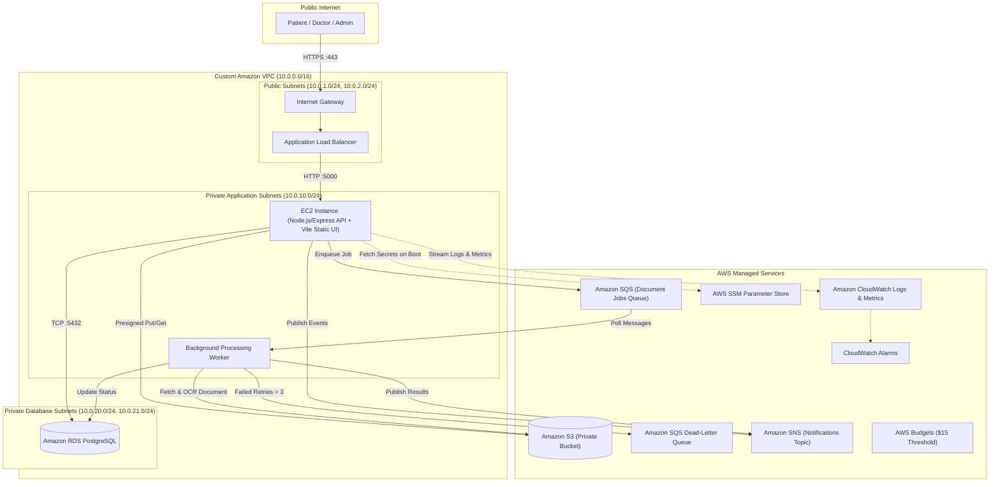

# MediCloud — Cloud-Based Healthcare Appointment, Medical Document Processing & Notification Platform

[](LICENSE)
[](https://nodejs.org/)
[](https://react.dev/)
[](https://www.typescriptlang.org/)
[](https://www.postgresql.org/)
[](https://aws.amazon.com/)

---

## 1. Executive Summary

**MediCloud** is a comprehensive, production-grade cloud computing mini project developed for third-year Computer Engineering students. It delivers an end-to-end healthcare workflow platform encompassing:
- **Patient Portal:** Doctor discovery by specialization, conflict-free appointment scheduling, rescheduling, cancellation, synthetic medical document upload, and status tracking.
- **Doctor Portal:** Availability slot management, assigned appointments overview, status updates, authorized document access, and prescription attachment.
- **Administrator Portal:** User management, doctor onboarding, system-wide appointment oversight, asynchronous document processing queue monitoring, real operational analytics, and audit logging.
- **AWS Cloud Native Foundation:** Deployed on Amazon EC2 inside a custom VPC with public and private subnets, backed by Amazon RDS PostgreSQL, Amazon S3 private document store, Amazon SQS asynchronous processing worker, Amazon SNS notifications, AWS Systems Manager Parameter Store, and Amazon CloudWatch monitoring/alarms.

> **EDUCATIONAL PROTOTYPE NOTICE:** MediCloud processes **strictly synthetic healthcare data**. It is an educational prototype and does not provide real clinical advice or medical diagnosis.

---

## 2. Architecture Overview



---

## 3. Technology Stack

| Domain | Technology | Purpose |
|---|---|---|
| **Frontend** | React 18, Vite, TypeScript | Modern reactive SPA interface |
| **Styling** | Vanilla CSS Tokens & Modules | High-aesthetic light/dark mode design system |
| **Icons** | Lucide React | Clean, accessible iconography |
| **Backend** | Node.js (v20+ LTS), Express.js, TypeScript | RESTful API server with centralized middleware |
| **Validation** | Zod | Runtime schema validation for all requests |
| **Database** | PostgreSQL 16 (Local) / Amazon RDS (Cloud) | ACID-compliant relational persistence |
| **Compute** | Amazon EC2 (`t3.micro` / `t4g.micro`) | Non-serverless primary compute host |
| **Storage** | Amazon S3 | Private encrypted document store with Presigned URLs |
| **Messaging** | Amazon SQS + Dead-Letter Queue | Decoupled asynchronous document processing |
| **Notifications**| Amazon SNS | Multi-channel broadcast & operational alerts |
| **Secrets** | AWS Systems Manager Parameter Store | Secure runtime configuration (`SecureString`) |
| **Monitoring** | Amazon CloudWatch & AWS Budgets | Structured logs, custom metrics, and spending alarms |

---

## 4. Quickstart Guide (Local Development)

### Prerequisites
- Node.js v20+ & npm 10+
- Docker & Docker Compose (for PostgreSQL)

### Step 1: Clone and Configure Environment
```bash
git clone <repo-url> medicloud
cd medicloud
cp .env.example .env
```

### Step 2: Start Local Database
```bash
docker compose up -d postgres
```

### Step 3: Setup Backend
```bash
cd backend
npm install
npm run db:migrate
npm run db:seed
npm run dev
```
Backend runs at `http://localhost:5000`.

### Step 4: Setup Frontend
```bash
cd ../frontend
npm install
npm run dev
```
Frontend runs at `http://localhost:5173`.

---

## 5. Seed Demo Accounts

| Role | Email | Password | Permissions |
|---|---|---|---|
| **Patient** | `sarah.jenkins@example.com` | `Password123!` | Book, reschedule, upload documents, view notifications |
| **Doctor** | `dr.marcus.vance@example.com` | `Password123!` | Manage availability, confirm appointments, review reports |
| **Admin** | `admin.elena@example.com` | `Password123!` | Onboard doctors, system monitoring, audit logs, analytics |

---

## 6. Project Layout

```
medicloud/
├── frontend/               # React + Vite TypeScript SPA
├── backend/                # Express TypeScript REST API & Worker
├── database/               # SQL migrations, seeds, and diagrams
├── cloud/                  # CloudFormation/Terraform IaC templates
│   ├── networking/         # VPC, Subnets, IGW, Security Groups
│   ├── deployment/         # EC2 UserData, RDS PostgreSQL templates
│   ├── iam/                # Least-privilege IAM policies
│   ├── monitoring/         # CloudWatch alarms and metrics
│   └── cost/               # AWS Budgets configuration
├── docs/                   # Academic report, architecture, API docs, viva
└── evidence/               # Test outputs, screenshots, cost calculations
```
