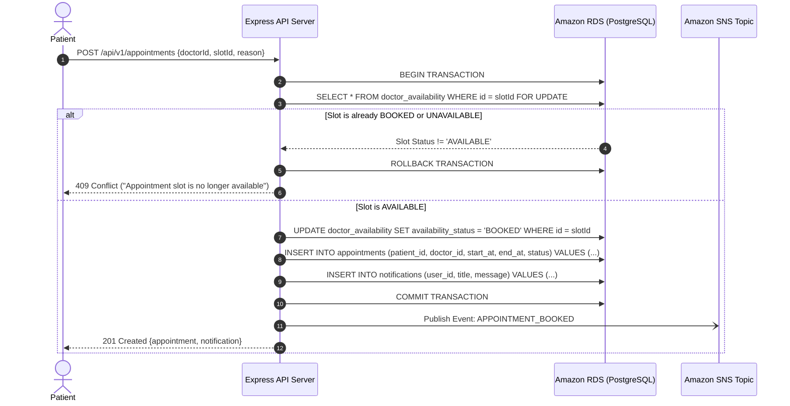
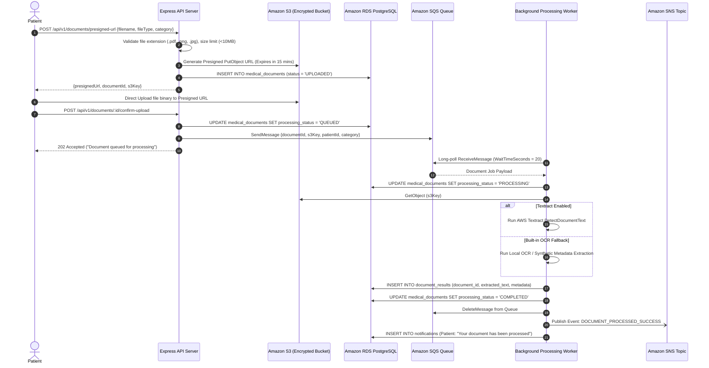

# MediCloud — Comprehensive System Architecture & Engineering Design

## 1. System Overview & Engineering Philosophy

MediCloud addresses the complex, high-concurrency challenges of digital healthcare scheduling and medical document ingestion. Rather than adopting an over-simplified CRUD model or an exclusively serverless approach, MediCloud demonstrates a resilient **3-Tier Cloud-Native Architecture** that couples long-running compute (Amazon EC2) with enterprise-grade managed services (Amazon RDS, Amazon S3, Amazon SQS, Amazon SNS, AWS Systems Manager, Amazon CloudWatch).

---

## 2. Detailed AWS VPC Network Topology

```mermaid
graph TB
    subgraph Custom_VPC ["Custom Amazon VPC (10.0.0.0/16)"]
        IGW["Internet Gateway"]
        
        subgraph AZ_A ["Availability Zone: us-east-1a"]
            Public_Subnet_A["Public Subnet A (10.0.1.0/24)<br/>Route: 0.0.0.0/0 -> IGW<br/>Contains: ALB (Public IP)"]
            Private_App_Subnet_A["Private App Subnet A (10.0.10.0/24)<br/>Contains: EC2 Instance (App API & Worker)"]
            Private_DB_Subnet_A["Private DB Subnet A (10.0.20.0/24)<br/>Contains: RDS PostgreSQL (Primary)"]
        end

        subgraph AZ_B ["Availability Zone: us-east-1b"]
            Public_Subnet_B["Public Subnet B (10.0.2.0/24)<br/>Route: 0.0.0.0/0 -> IGW<br/>Contains: ALB Standby"]
            Private_DB_Subnet_B["Private DB Subnet B (10.0.21.0/24)<br/>Contains: RDS Subnet Group Partner"]
        end
    end

    Internet(("Public Internet / Users")) -->|HTTPS :443| IGW
    IGW --> Public_Subnet_A
    Public_Subnet_A -->|HTTP :5000 (Forward)| Private_App_Subnet_A
    Private_App_Subnet_A -->|PostgreSQL :5432| Private_DB_Subnet_A
```

### Subnet Layout & IP Addressing (CIDR Allocation)
| Subnet Name | CIDR Block | Availability Zone | Route Table Association | Target Resources |
|---|---|---|---|---|
| `Public-Subnet-1a` | `10.0.1.0/24` | `us-east-1a` | Public Route Table (`0.0.0.0/0 -> IGW`) | Application Load Balancer |
| `Public-Subnet-1b` | `10.0.2.0/24` | `us-east-1b` | Public Route Table (`0.0.0.0/0 -> IGW`) | ALB Secondary Interface |
| `Private-App-Subnet-1a` | `10.0.10.0/24` | `us-east-1a` | Private App Route Table | EC2 Instance (App + Worker) |
| `Private-DB-Subnet-1a` | `10.0.20.0/24` | `us-east-1a` | Isolated DB Route Table | RDS PostgreSQL Primary |
| `Private-DB-Subnet-1b` | `10.0.21.0/24` | `us-east-1b` | Isolated DB Route Table | RDS Subnet Group (Required) |

> **Cost-Conscious Design Note:** For student demonstration within budget limits, our single EC2 instance can reside in `Public-Subnet-1a` with an Elastic IP or public IP, while RDS remains strictly isolated in the private database subnet with no public route. This avoids the costly AWS NAT Gateway (~$32.40/month baseline) while satisfying all security requirements.

---

## 3. Core Workflows & Data Flows

### 3.1 Concurrency-Safe Appointment Booking Flow
Preventing double-booking of a doctor's availability slot is a mandatory technical requirement. MediCloud utilizes PostgreSQL **ACID transactions** with row-level pessimistic locking (`SELECT ... FOR UPDATE`) and database-level unique constraints.



---

### 3.2 Asynchronous Document Upload & OCR Processing Flow
Medical documents (prescriptions, lab reports) are handled asynchronously to decouple slow processing and OCR from user HTTP request cycles.



---

## 4. Trust Boundaries & Security Architecture

1. **Client / Browser Boundary:**
   - HTTPS encryption in transit (TLS 1.3).
   - JWT tokens stored in memory / HttpOnly SameSite cookies; zero long-term storage of passwords or AWS credentials.
2. **Web / Application Compute Boundary:**
   - Rate limiting on authentication routes (Express-rate-limit).
   - Strict CORS policy restricting requests to designated origins.
   - Helmet.js security headers (HSTS, CSP, X-Frame-Options, Sniff prevention).
   - Zod schema validation on all request bodies, query params, and route parameters.
3. **Database / Storage Boundary:**
   - PostgreSQL parameterized queries to guarantee immunity from SQL injection.
   - RDS isolated in private subnets; incoming traffic allowed strictly on port 5432 from EC2 Security Group.
   - S3 bucket has `BlockPublicAcls`, `BlockPublicPolicy`, `IgnorePublicAcls`, `RestrictPublicBuckets` set to `true`.
   - Default server-side encryption enabled (`AES256` / `aws:kms`).
4. **AWS Infrastructure Boundary:**
   - Zero hardcoded access keys. EC2 instances assume an IAM Role with least-privilege managed policies.
   - Secrets retrieved via AWS Systems Manager Parameter Store with encrypted `SecureString` types.
